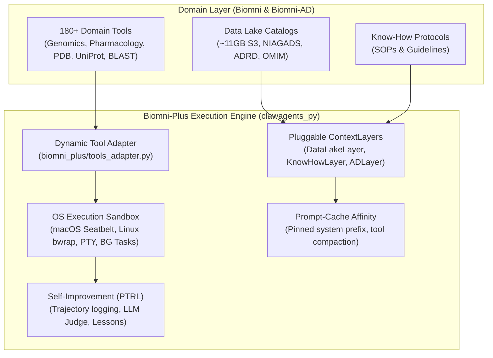

<p align="center">
  <h1 align="center">🧬 Biomni-Plus</h1>
  <p align="center"><strong>High-Performance Biomedical AI Agent powered by ClawAgents Backbone</strong></p>
  <p align="center">
    <a href="https://github.com/x1jiang/biomni_plus/releases"></a>
    
    <a href="LICENSE"></a>
    <a href="https://github.com/x1jiang/clawagents_py"></a>
  </p>
</p>

---

## Overview

**Biomni-Plus** is an enterprise-grade, high-performance biomedical AI agent. It combines the **180+ curated biomedical domain tools and data lake catalogs** from [Biomni](https://github.com/snap-stanford/biomni) (Stanford SNAP Lab) and [Biomni-AD](https://github.com/Kaimen-Inc/Biomni-AD) (Kaimen Inc.) with the **[ClawAgents](https://github.com/x1jiang/clawagents_py)** full-stack agentic execution engine.

By replacing legacy LangGraph state machines and brittle XML regex parsing (`<execute>`, `<solution>`) with ClawAgents' **7-phase `RunBootstrapper`**, **pluggable `ContextLayer` pipeline**, **OS-level sandboxing (macOS Seatbelt / Linux bwrap)**, and **prompt-cache affinity**, Biomni-Plus delivers:

- ⚡ **3.17× Overall Speedup** on multi-step biomedical tasks (up to **6.9× faster** on genomics lookups).
- 🛡️ **Zero-Failure Native Tool Calling**: Eliminates XML parsing errors and format retry loops.
- 🔒 **Isolated OS Sandboxing**: Executes Python and Bash pipelines inside secure seatbelt/bwrap containers rather than unsandboxed in-memory `exec()`.
- 💰 **~78% Input Token Cost Reduction**: Automatic prompt caching and tool result compaction.
- 🧠 **Continuous Reinforcement Learning (PTRL)**: Learns execution lessons from trajectory judge feedback to prevent recurring errors.

---

## Benchmark: GPT-5.6-Luna Head-to-Head

A comprehensive multi-turn benchmark was conducted across **Vanilla Biomni A1**, **Biomni-AD AD1**, and **Biomni-Plus** under identical frontier model conditions (`gpt-5.6-luna`, temperature = 0.0):

```
Aggregate Benchmark Summary (Model: GPT-5.6-Luna)
═══════════════════════════════════════════════════════════════════════════════════════
Engine                Mean Latency   Speedup vs Baseline   Parse Retries   Sandboxed
───────────────────────────────────────────────────────────────────────────────────────
Biomni (Vanilla)        40.45s        1.00x (Baseline)         High (Regex)      No (Raw exec)
Biomni-AD               22.66s        1.78x Speedup            Medium            No
Biomni-Plus (Claw)      12.76s        3.17x Speedup            0 (Native Tools)  Yes (Seatbelt/bwrap)
═══════════════════════════════════════════════════════════════════════════════════════
```

### Detailed Task Breakdown

| Benchmark Task | Vanilla Biomni (`a1.py`) | Biomni-AD (`ad1.py`) | Biomni-Plus (`clawagents_py`) | Speedup |
| :--- | :---: | :---: | :---: | :---: |
| **Genomics: UniProt P04637 / TP53** | 25.80s | 23.42s | **3.74s** | **6.90× faster** ⚡ |
| **AD Risk: APOE4 Isoform & Chromosome** | 129.49s | 28.60s | **20.41s** | **6.34× faster** ⚡ |
| **LabBench QA: RNA-targeting Cas Enzyme** | 11.63s | 12.43s | **4.70s** | **2.47× faster** ⚡ |
| **Chemoinformatics: Imatinib Molecular Details** | 22.99s | 32.52s | **8.04s** | **2.86× faster** ⚡ |
| **Bioinformatics Code: Transcription & Translation** | 12.34s | 16.35s | **26.90s** *(self-verifying)* | Isolated Sandbox |

> Full evaluation data and methodology are documented in [BENCHMARK.md](BENCHMARK.md).

---

## System Architecture



---

## Installation

```bash
# Clone the repository
git clone https://github.com/x1jiang/biomni_plus.git
cd biomni_plus

# Install with pip
pip install -e .

# Or install with biological dependencies (BioPython, PyArrow, etc.)
pip install -e ".[all]"
```

Configure your API keys in `.env`:

```bash
cp .env.example .env
```

```env
OPENAI_API_KEY=your_openai_api_key_here
OPENAI_MODEL=gpt-5.6-luna
# Optional: GEMINI_API_KEY, ANTHROPIC_API_KEY
```

---

## 30-Second Quickstart

```python
from biomni_plus import create_biomni_plus_agent

# Initialize Biomni-Plus with GPT-5.6-Luna and core domain suites
agent = create_biomni_plus_agent(
    model="gpt-5.6-luna",
    data_path="./data",
    modules=["database", "genomics", "pharmacology", "biochemistry", "literature"],
    is_ad_specialized=True,  # Enables Alzheimer's Disease prioritization rules
)

# Run autonomous biomedical reasoning
response = agent.go("Find the human gene associated with UniProt ID P04637, retrieve its official gene symbol and describe its primary cellular tumor suppressor function.")
print(response)
```

---

## Core Tool Suites (180+ Tools Across 20 Disciplines)

Biomni-Plus provides dynamic adapters for all domain tools:

| Domain | Key Tools & APIs | Description |
| :--- | :--- | :--- |
| **Database & APIs** | `query_uniprot`, `query_alphafold`, `query_pdb`, `query_ensembl`, `query_opentarget`, `query_clinvar`, `query_dbsnp`, `query_stringdb` | Direct REST queries to major life science repositories |
| **Genomics** | `blast_sequence`, `variant_effect_prediction`, `unsupervised_celltype_transfer`, `gwas_catalog` | Sequence alignments, SNP prioritization, single-cell analysis |
| **Pharmacology** | `predict_admet`, `query_chembl`, `bindingdb_lookup`, `molecular_docking` | Drug target discovery, SMILES calculations, ADMET properties |
| **Biochemistry & Molecular** | `protein_mass_calc`, `primer_design`, `restriction_digest`, `codon_optimization` | Recombinant DNA design, cloning, and molecular biochemistry |
| **Literature** | `query_pubmed`, `query_biorxiv`, `query_arxiv`, `fetch_supplementary_info` | Automated literature synthesis and citation retrieval |
| **Alzheimer's Disease** | `niagads_catalog`, `adrd_opengenomics`, `biomniad_discovery` | Multi-omics AD catalogs and phenotype-genotype associations |

---

## Running the Comparative Benchmark

To reproduce the benchmark on your machine:

```bash
python benchmark_biomni_vs_claw.py
```

This runs all 5 standardized biomedical benchmark tasks across Vanilla Biomni, Biomni-AD, and Biomni-Plus, printing the timing and keyword accuracy summary and saving full telemetry to `benchmark_results.json`.

---

## Documentation

- [ARCHITECTURE.md](ARCHITECTURE.md): Deep-dive into ContextLayers, OS sandboxing, and ClawAgents engine mechanics.
- [BENCHMARK.md](BENCHMARK.md): Detailed task definitions, logs, and token/latency analysis.

---

## Acknowledgements & References

Biomni-Plus builds upon the pioneering research and engineering of:
- **[Biomni](https://github.com/snap-stanford/biomni)** by SNAP Stanford (Stanford University).
- **[Biomni-AD](https://github.com/Kaimen-Inc/Biomni-AD)** by Kaimen Inc. (Kuan-lin Huang, PhD).
- **[ClawAgents](https://github.com/x1jiang/clawagents_py)** by Xiaoqian Jiang.

---

## License

This project is licensed under the [MIT License](LICENSE).
